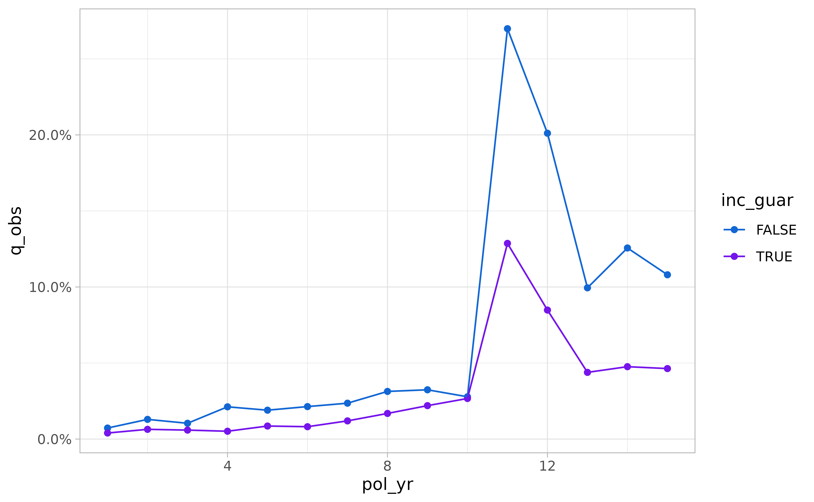
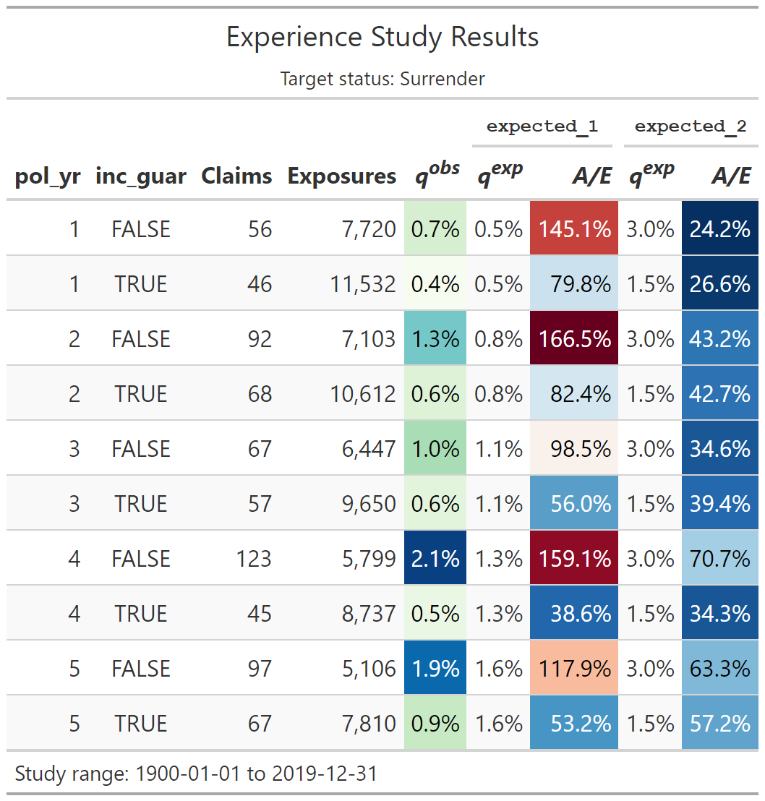
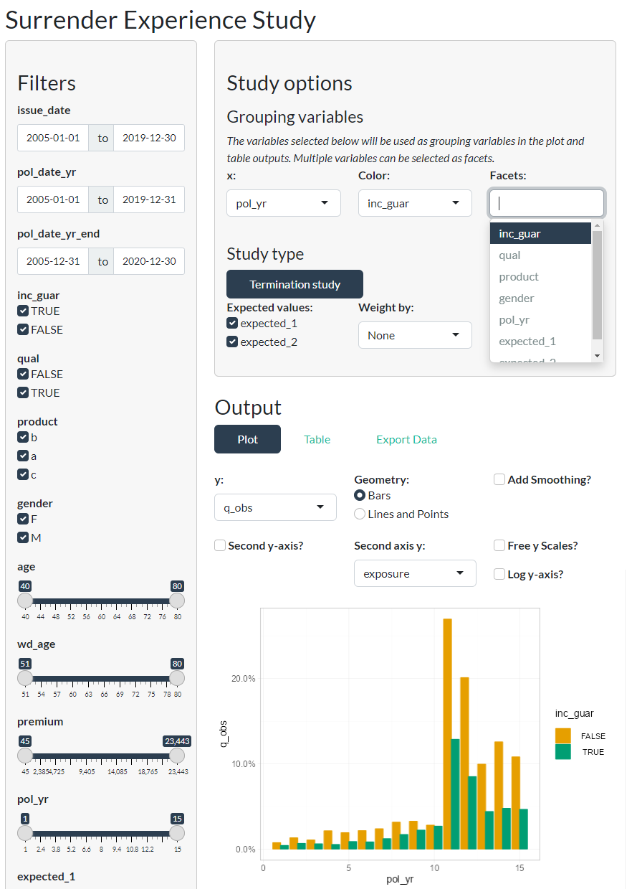

# Getting started with actxps

This article is based on creating a termination study using sample data
that comes with the actxps package. For information on transaction
studies, see
[`vignette("transactions")`](https://mattheaphy.github.io/actxps/articles/transactions.md).

## Simulated data set

The actxps package includes a data frame containing simulated census
data for a theoretical deferred annuity product with an optional
guaranteed income rider. The grain of this data is one row per policy.

``` r

library(actxps)
library(dplyr)

census_dat
#> # A tibble: 20,000 × 11
#>    pol_num status  issue_date inc_guar qual    age product gender wd_age premium
#>      <int> <fct>   <date>     <lgl>    <lgl> <int> <fct>   <fct>   <int>   <dbl>
#>  1       1 Active  2014-12-17 TRUE     FALSE    56 b       F          77     370
#>  2       2 Surren… 2007-09-24 FALSE    FALSE    71 a       F          71     708
#>  3       3 Active  2012-10-06 FALSE    TRUE     62 b       F          63     466
#>  4       4 Surren… 2005-06-27 TRUE     TRUE     62 c       M          62     485
#>  5       5 Active  2019-11-22 FALSE    FALSE    62 c       F          67     978
#>  6       6 Active  2018-09-01 FALSE    TRUE     77 a       F          77    1288
#>  7       7 Active  2011-07-23 TRUE     TRUE     63 a       M          65    1046
#>  8       8 Active  2005-11-08 TRUE     TRUE     58 a       M          58    1956
#>  9       9 Active  2010-09-19 FALSE    FALSE    53 c       M          64    2165
#> 10      10 Active  2012-05-25 TRUE     FALSE    61 b       M          73     609
#> # ℹ 19,990 more rows
#> # ℹ 1 more variable: term_date <date>
```

The data includes 3 policy statuses: Active, Death, and Surrender.

``` r

(status_counts <- table(census_dat$status))
#> 
#>    Active     Death Surrender 
#>     15212      1816      2972
```

Let’s assume we’re interested in calculating the probability of
surrender over one policy year. We cannot simply calculate the
proportion of policies in a surrendered status as this does not
represent an annualized surrender rate.

``` r

# incorrect
prop.table(status_counts)
#> 
#>    Active     Death Surrender 
#>    0.7606    0.0908    0.1486
```

## Creating exposed data

In order to calculate annual surrender rates, we need to break each
policy into multiple records. There should be one row per policy per
year.

The
[`expose()`](https://mattheaphy.github.io/actxps/reference/expose.md)
family of functions is used to perform this transformation.

``` r

exposed_data <- expose(
  census_dat,
  end_date = "2019-12-31",
  target_status = "Surrender"
)

exposed_data
#> 
#> ── Exposure data ──
#> 
#> • Exposure type: policy_year
#> • Target status: Surrender
#> • Study range: 1900-01-01 to 2019-12-31
#> 
#> # A tibble: 141,252 × 15
#>    pol_num status issue_date inc_guar qual    age product gender wd_age premium
#>      <int> <fct>  <date>     <lgl>    <lgl> <int> <fct>   <fct>   <int>   <dbl>
#>  1       1 Active 2014-12-17 TRUE     FALSE    56 b       F          77     370
#>  2       1 Active 2014-12-17 TRUE     FALSE    56 b       F          77     370
#>  3       1 Active 2014-12-17 TRUE     FALSE    56 b       F          77     370
#>  4       1 Active 2014-12-17 TRUE     FALSE    56 b       F          77     370
#>  5       1 Active 2014-12-17 TRUE     FALSE    56 b       F          77     370
#>  6       1 Active 2014-12-17 TRUE     FALSE    56 b       F          77     370
#>  7       2 Active 2007-09-24 FALSE    FALSE    71 a       F          71     708
#>  8       2 Active 2007-09-24 FALSE    FALSE    71 a       F          71     708
#>  9       2 Active 2007-09-24 FALSE    FALSE    71 a       F          71     708
#> 10       2 Active 2007-09-24 FALSE    FALSE    71 a       F          71     708
#> # ℹ 141,242 more rows
#> # ℹ 5 more variables: term_date <date>, pol_yr <int>, pol_date_yr <date>,
#> #   pol_date_yr_end <date>, exposure <dbl>
```

These functions create `exposed_df` objects, which are a type of data
frame with some additional attributes related to the experience study.

Now that the data has been “exposed” by policy year, the observed annual
surrender probability can be calculated as:

``` r

sum(exposed_data$status == "Surrender") / sum(exposed_data$exposure)
#> [1] 0.02163097
```

As a default, the
[`expose()`](https://mattheaphy.github.io/actxps/reference/expose.md)
function calculates exposures by policy year. This can also be
accomplished with the function
[`expose_py()`](https://mattheaphy.github.io/actxps/reference/expose.md).
Other implementations of
[`expose()`](https://mattheaphy.github.io/actxps/reference/expose.md)
include:

- `expose_cy` = exposures by calendar year
- `expose_cq` = exposures by calendar quarter
- `expose_cm` = exposures by calendar month
- `expose_cw` = exposures by calendar week
- `expose_pq` = exposures by policy quarter
- `expose_pm` = exposures by policy month
- `expose_pw` = exposures by policy week

See
[`vignette("exposures")`](https://mattheaphy.github.io/actxps/articles/exposures.md)
for further details on exposure calculations.

## Experience study summary function

The
[`exp_stats()`](https://mattheaphy.github.io/actxps/reference/exp_stats.md)
function creates a summary of observed experience data. The output of
this function is an `exp_df` object.

``` r

exp_stats(exposed_data)
#> 
#> ── Experience study results ──
#> 
#> • Target status: Surrender
#> • Study range: 1900-01-01 to 2019-12-31
#> 
#> # A tibble: 1 × 4
#>   n_claims claims exposure  q_obs
#>      <int>  <int>    <dbl>  <dbl>
#> 1     2869   2869  132634. 0.0216
```

See
[`vignette("exp_summary")`](https://mattheaphy.github.io/actxps/articles/exp_summary.md)
for further details on exposure calculations.

### Grouped experience data

If the data frame passed into
[`exp_stats()`](https://mattheaphy.github.io/actxps/reference/exp_stats.md)
is grouped using
[`dplyr::group_by()`](https://dplyr.tidyverse.org/reference/group_by.html),
the resulting output will contain one record for each unique group.

``` r

exp_res <- exposed_data |>
  group_by(pol_yr, inc_guar) |>
  exp_stats()

exp_res
#> 
#> ── Experience study results ──
#> 
#> • Groups: pol_yr and inc_guar
#> • Target status: Surrender
#> • Study range: 1900-01-01 to 2019-12-31
#> 
#> # A tibble: 30 × 6
#>    pol_yr inc_guar n_claims claims exposure   q_obs
#>     <int> <lgl>       <int>  <int>    <dbl>   <dbl>
#>  1      1 FALSE          56     56    7720. 0.00725
#>  2      1 TRUE           46     46   11532. 0.00399
#>  3      2 FALSE          92     92    7103. 0.0130 
#>  4      2 TRUE           68     68   10612. 0.00641
#>  5      3 FALSE          67     67    6447. 0.0104 
#>  6      3 TRUE           57     57    9650. 0.00591
#>  7      4 FALSE         123    123    5799. 0.0212 
#>  8      4 TRUE           45     45    8737. 0.00515
#>  9      5 FALSE          97     97    5106. 0.0190 
#> 10      5 TRUE           67     67    7810. 0.00858
#> # ℹ 20 more rows
```

### Actual-to-expected rates

To derive actual-to-expected rates, first attach one or more columns of
expected termination rates to the exposure data. Then, pass these column
names to the `expected` argument of
[`exp_stats()`](https://mattheaphy.github.io/actxps/reference/exp_stats.md).

``` r

expected_table <- c(seq(0.005, 0.03, length.out = 10), 0.2, 0.15, rep(0.05, 3))

# using 2 different expected termination rates
exposed_data <- exposed_data |>
  mutate(
    expected_1 = expected_table[pol_yr],
    expected_2 = ifelse(exposed_data$inc_guar, 0.015, 0.03)
  )

exp_res <- exposed_data |>
  group_by(pol_yr, inc_guar) |>
  exp_stats(expected = c("expected_1", "expected_2"))

exp_res
#> 
#> ── Experience study results ──
#> 
#> • Groups: pol_yr and inc_guar
#> • Target status: Surrender
#> • Study range: 1900-01-01 to 2019-12-31
#> • Expected values: expected_1 and expected_2
#> 
#> # A tibble: 30 × 10
#>    pol_yr inc_guar n_claims claims exposure   q_obs expected_1 expected_2
#>     <int> <lgl>       <int>  <int>    <dbl>   <dbl>      <dbl>      <dbl>
#>  1      1 FALSE          56     56    7720. 0.00725    0.005        0.03 
#>  2      1 TRUE           46     46   11532. 0.00399    0.005        0.015
#>  3      2 FALSE          92     92    7103. 0.0130     0.00778      0.03 
#>  4      2 TRUE           68     68   10612. 0.00641    0.00778      0.015
#>  5      3 FALSE          67     67    6447. 0.0104     0.0106       0.03 
#>  6      3 TRUE           57     57    9650. 0.00591    0.0106       0.015
#>  7      4 FALSE         123    123    5799. 0.0212     0.0133       0.03 
#>  8      4 TRUE           45     45    8737. 0.00515    0.0133       0.015
#>  9      5 FALSE          97     97    5106. 0.0190     0.0161       0.03 
#> 10      5 TRUE           67     67    7810. 0.00858    0.0161       0.015
#> # ℹ 20 more rows
#> # ℹ 2 more variables: ae_expected_1 <dbl>, ae_expected_2 <dbl>
```

### `autoplot()` and `autotable()`

The
[`autoplot()`](https://ggplot2.tidyverse.org/reference/autoplot.html)
and
[`autotable()`](https://mattheaphy.github.io/actxps/reference/autotable.md)
functions create visualizations and summary tables. See
`vignette("visualizations")` for full details on these functions.

``` r

autoplot(exp_res)
```



``` r

# first 10 rows showed for brevity
exp_res |> head(10) |> autotable()
```



### `summary()`

Calling the [`summary()`](https://rdrr.io/r/base/summary.html) function
on an `exp_df` object re-summarizes experience results. This also
produces an `exp_df` object.

``` r

summary(exp_res)
#> 
#> ── Experience study results ──
#> 
#> • Target status: Surrender
#> • Study range: 1900-01-01 to 2019-12-31
#> • Expected values: expected_1 and expected_2
#> 
#> # A tibble: 1 × 8
#>   n_claims claims exposure  q_obs expected_1 expected_2 ae_expected_1
#>      <int>  <int>    <dbl>  <dbl>      <dbl>      <dbl>         <dbl>
#> 1     2869   2869  132634. 0.0216     0.0242     0.0209         0.892
#> # ℹ 1 more variable: ae_expected_2 <dbl>
```

If additional variables are passed to `...`, these variables become
groups in the re-summarized `exp_df` object.

``` r

summary(exp_res, inc_guar)
#> 
#> ── Experience study results ──
#> 
#> • Groups: inc_guar
#> • Target status: Surrender
#> • Study range: 1900-01-01 to 2019-12-31
#> • Expected values: expected_1 and expected_2
#> 
#> # A tibble: 2 × 9
#>   inc_guar n_claims claims exposure  q_obs expected_1 expected_2 ae_expected_1
#>   <lgl>       <int>  <int>    <dbl>  <dbl>      <dbl>      <dbl>         <dbl>
#> 1 FALSE        1601   1601   52123. 0.0307     0.0235      0.03          1.31 
#> 2 TRUE         1268   1268   80511. 0.0157     0.0247      0.015         0.637
#> # ℹ 1 more variable: ae_expected_2 <dbl>
```

## Shiny App

Passing an `exposed_df` object to the
[`exp_shiny()`](https://mattheaphy.github.io/actxps/reference/exp_shiny.md)
function launches a Shiny app that enables interactive exploration of
experience data.

``` r

exp_shiny(exposed_data)
```


