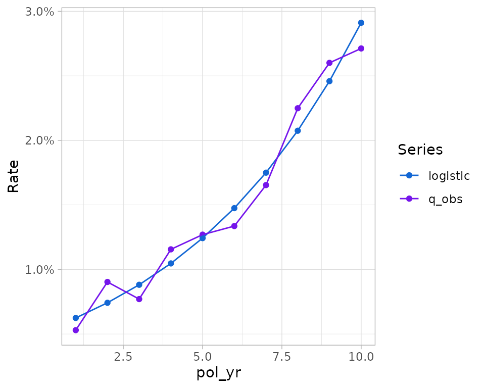

# Other functions

This vignette features functions that are not covered in other
vignettes.

``` r

library(actxps)
library(clock)
```

## Working with aggregate experience data

Seriatim-level policy experience data is often not available for
analysis. This is almost always the case with industry studies that
contain experience data submitted by multiple parties. In these cases,
experience is grouped by a several common policy attributes and
aggregated accordingly.

The typical workflow in actxps of `expose() |> exp_stats()` for
termination studies or `expose() |> add_transactions() |> trx_stats()`
for transaction studies doesn’t apply if the starting data is
aggregated. That is because another party has already gone through the
steps of creating exposure records and performing an initial level of
aggregation.

Actxps provides two functions designed to work with aggregate experience
data.

- For termination studies,
  [`as_exp_df()`](https://mattheaphy.github.io/actxps/reference/as_exp_df.md)
  converts a data frame of aggregate experience into an `exp_df` object,
  which is the class returned by
  [`exp_stats()`](https://mattheaphy.github.io/actxps/reference/exp_stats.md)
  = For transaction studies,
  [`as_trx_df()`](https://mattheaphy.github.io/actxps/reference/as_trx_df.md)
  converts a data frame of aggregate experience into a `trx_df` object,
  which is the class returned by
  [`trx_stats()`](https://mattheaphy.github.io/actxps/reference/trx_stats.md)

Both object classes have a
[`summary()`](https://rdrr.io/r/base/summary.html) method which
summarizes experience across any grouping variables passed to the
function. The output of
[`summary()`](https://rdrr.io/r/base/summary.html) will always be
another `exp_df` (or `trx_df`) object, and will look just like the
results of
[`exp_stats()`](https://mattheaphy.github.io/actxps/reference/exp_stats.md)
(or
[`trx_stats()`](https://mattheaphy.github.io/actxps/reference/trx_stats.md)).
For downstream reporting, summary results can be passed to the
visualization functions
[`autoplot()`](https://ggplot2.tidyverse.org/reference/autoplot.html)
and
[`autotable()`](https://mattheaphy.github.io/actxps/reference/autotable.md).

The `agg_sim_dat` data set contains aggregate experience on a
theoretical block of deferred annuity contracts. Below,
[`as_exp_df()`](https://mattheaphy.github.io/actxps/reference/as_exp_df.md)
is used to convert the data to an `exp_df`, and
[`summary()`](https://rdrr.io/r/base/summary.html) is called using
multiple grouping variables.

``` r

agg_sim_exp_df <- agg_sim_dat |>
  as_exp_df(
    col_exposure = "exposure_n",
    col_claims = "claims_n",
    conf_int = TRUE,
    start_date = 2005,
    end_date = 2019,
    target_status = "Surrender"
  )
```

Results summarized by policy year

``` r

summary(agg_sim_exp_df, pol_yr)
#> 
#> ── Experience study results ──
#> 
#> • Groups: pol_yr
#> • Target status: Surrender
#> • Study range: 2005 to 2019
#> 
#> # A tibble: 15 × 7
#>    pol_yr n_claims claims exposure   q_obs q_obs_lower q_obs_upper
#>     <int>    <int>  <int>    <dbl>   <dbl>       <dbl>       <dbl>
#>  1      1      102    102   19252. 0.00530     0.00431     0.00634
#>  2      2      160    160   17715. 0.00903     0.00768     0.0104 
#>  3      3      124    124   16097. 0.00770     0.00640     0.00907
#>  4      4      168    168   14536. 0.0116      0.00984     0.0133 
#>  5      5      164    164   12916. 0.0127      0.0108      0.0146 
#>  6      6      152    152   11376. 0.0134      0.0113      0.0155 
#>  7      7      164    164    9917. 0.0165      0.0141      0.0191 
#>  8      8      190    190    8448. 0.0225      0.0194      0.0257 
#>  9      9      181    181    6960. 0.0260      0.0223      0.0297 
#> 10     10      152    152    5604. 0.0271      0.0230      0.0314 
#> 11     11      804    804    4390. 0.183       0.172       0.195  
#> 12     12      330    330    2663. 0.124       0.112       0.137  
#> 13     13       99     99    1620. 0.0611      0.0500      0.0728 
#> 14     14       62     62     872. 0.0711      0.0551      0.0883 
#> 15     15       17     17     268. 0.0634      0.0373      0.0932
```

Results summarized by income guarantee presence and product

``` r

summary(agg_sim_exp_df, inc_guar, product)
#> 
#> ── Experience study results ──
#> 
#> • Groups: inc_guar and product
#> • Target status: Surrender
#> • Study range: 2005 to 2019
#> 
#> # A tibble: 6 × 8
#>   inc_guar product n_claims claims exposure  q_obs q_obs_lower q_obs_upper
#>   <lgl>    <fct>      <int>  <int>    <dbl>  <dbl>       <dbl>       <dbl>
#> 1 FALSE    a            449    449   12738. 0.0352      0.0321      0.0385
#> 2 FALSE    b            392    392   13490. 0.0291      0.0262      0.0320
#> 3 FALSE    c            760    760   25895. 0.0293      0.0273      0.0314
#> 4 TRUE     a            361    361   19966. 0.0181      0.0163      0.0199
#> 5 TRUE     b            273    273   19694. 0.0139      0.0122      0.0155
#> 6 TRUE     c            634    634   40851. 0.0155      0.0143      0.0167
```

[`as_exp_df()`](https://mattheaphy.github.io/actxps/reference/as_exp_df.md)
and
[`as_trx_df()`](https://mattheaphy.github.io/actxps/reference/as_trx_df.md)
contain several arguments for optional calculations like confidence
intervals, expected values, weighting variables, and more. These
arguments mirror the functionality in
[`exp_stats()`](https://mattheaphy.github.io/actxps/reference/exp_stats.md)
and
[`trx_stats()`](https://mattheaphy.github.io/actxps/reference/trx_stats.md).
Both functions also contain multiple arguments for specifying column
names associated with required values like exposures and claims.

## Policy duration functions

The `pol_()` family of functions calculates policy years, months,
quarters, or weeks. Each function accepts a vector of dates and a vector
of issue dates.

**Example**: assume a policy was issued on 2022-05-10 and we are
interested in calculating various policy duration values at the end of
calendar years 2022-2032.

``` r

dates <- date_build(2022 + 0:10, 12, 31)

# policy years
pol_yr(dates, "2022-05-10")
#>  [1]  1  2  3  4  5  6  7  8  9 10 11

# policy quarters
pol_qtr(dates, "2022-05-10")
#>  [1]  3  7 11 15 19 23 27 31 35 39 43

# policy months
pol_mth(dates, "2022-05-10")
#>  [1]   8  20  32  44  56  68  80  92 104 116 128

# policy weeks
pol_wk(dates, "2022-05-10")
#>  [1]  34  86 139 191 243 295 347 399 452 504 556
```

## Predictive modeling support functions

The
[`add_predictions()`](https://mattheaphy.github.io/actxps/reference/add_predictions.md)
function attaches predictions from any model with a
[`predict()`](https://rdrr.io/r/stats/predict.html) method.

Below, a very simple logistic regression model is fit to surrender
experience in the first ten policy years. Predictions from this model
are then added to exposure records using
[`add_predictions()`](https://mattheaphy.github.io/actxps/reference/add_predictions.md).
This function only requires a data frame of exposure records and a model
with a [`predict()`](https://rdrr.io/r/stats/predict.html) method.
Often, it is necessary to specify additional model-specific arguments
like `type` to ensure
[`predict()`](https://rdrr.io/r/stats/predict.html) returns the desired
output. In the example below, `type` is set to “response” to return
probabilities instead of the default predictions on the log-odds scale.

The `col_expected` argument is used to rename the column(s) containing
predicted values. If no names are specified, the default name is
“expected”.

``` r

# create exposure records
exposed_data <- expose(
  census_dat,
  end_date = "2019-12-31",
  target_status = "Surrender"
) |>
  filter(pol_yr <= 10) |>
  # add a response column for surrenders
  mutate(surrendered = status == "Surrender")

# create a simple logistic model
mod <- glm(
  surrendered ~ pol_yr,
  data = exposed_data,
  family = "binomial",
  weights = exposure
)

exp_res <- exposed_data |>
  # attach predictions
  add_predictions(mod, type = "response", col_expected = "logistic") |>
  # summarize results
  group_by(pol_yr) |>
  exp_stats(expected = "logistic")

# create a plot
plot_termination_rates(exp_res)
```



In addition, for users of the tidymodels framework, the actxps package
includes a recipe step function,
[`step_expose()`](https://mattheaphy.github.io/actxps/reference/step_expose.md),
that can apply the
[`expose()`](https://mattheaphy.github.io/actxps/reference/expose.md)
function during data preprocessing.

``` r

library(recipes)
#> Loading required package: dplyr
#> 
#> Attaching package: 'dplyr'
#> The following objects are masked from 'package:stats':
#> 
#>     filter, lag
#> The following objects are masked from 'package:base':
#> 
#>     intersect, setdiff, setequal, union
#> 
#> Attaching package: 'recipes'
#> The following object is masked from 'package:stats':
#> 
#>     step

recipe(~., data = census_dat) |>
  step_expose(end_date = "2019-12-31", target_status = "Surrender")
#> 
#> ── Recipe ──────────────────────────────────────────────────────────────────────
#> 
#> ── Inputs
#> Number of variables by role
#> predictor: 11
#> 
#> ── Operations
#> • Exposed data based on policy years for target status Surrender: <none>
```
