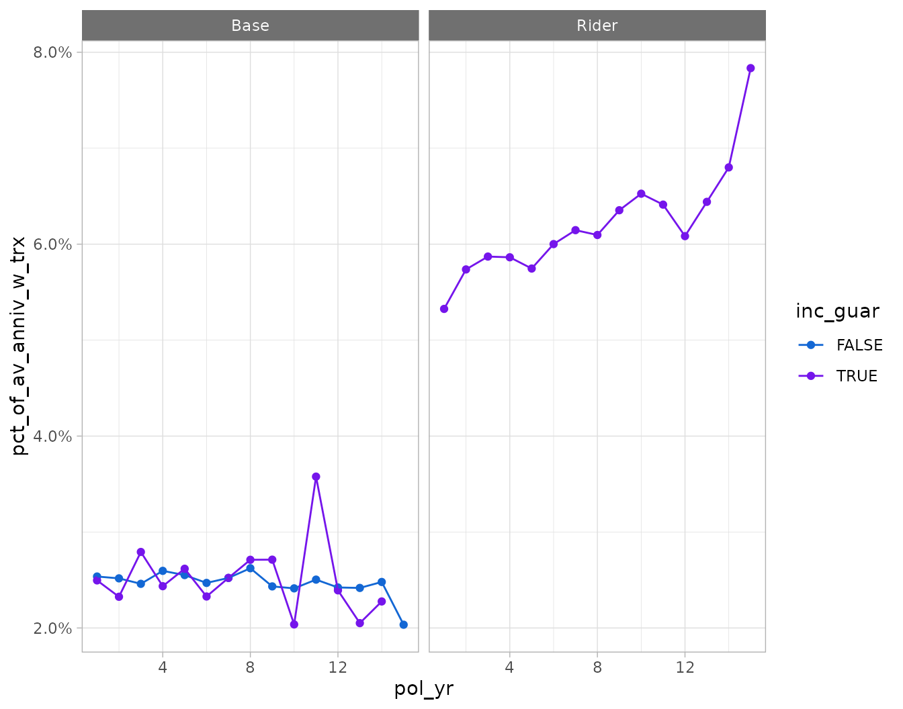
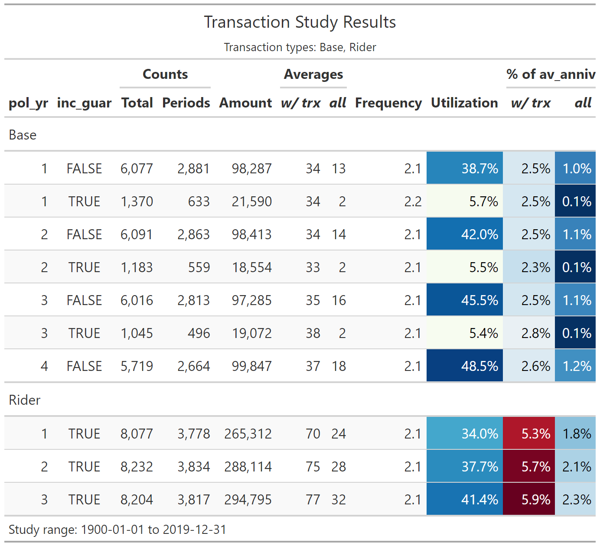

# Transaction studies

This article walks through an example of creating a **transaction
study** using the actxps package. Unlike a termination study,
transaction studies track events that can occur multiple times over the
life of a policy. Often, transactions are expected to reoccur; for
example, the utilization of a guaranteed income stream.

Key questions to answer in a transaction study are:

- What types of transactions occurred?
- What is the count, amount, and average size of observed transactions?
- What percentage of policies have transactions each exposure period?
- How do transactions compare to expectations?
- What is the rate of transaction amounts as a percentage of another
  value?

The example below walks through preparing data by adding transaction
information to a data frame with exposure-level records using the
[`add_transactions()`](https://mattheaphy.github.io/actxps/reference/add_transactions.md)
function. Next, study results are summarized using the
[`trx_stats()`](https://mattheaphy.github.io/actxps/reference/trx_stats.md)
function.

## Simulated transaction and account value data

In this example, we’ll be using the `census_dat`, `withdrawals`, and
`account_vals` data sets. Each data set is based on a theoretical block
of deferred annuity business with a guaranteed lifetime income benefit.

- `census_dat` contains census-level information with one row per policy
- `withdrawals` contains withdrawal transactions. There are 2 types of
  transactions in the data: “Base” (ordinary withdrawals) and “Rider”
  (guaranteed income payments).
- `account_vals` contains historical account values on policy
  anniversaries. This data will be used to calculate withdrawal rates as
  a percentage of account values.

## The `add_transactions()` function

The
[`add_transactions()`](https://mattheaphy.github.io/actxps/reference/add_transactions.md)
function attaches transactions to a data frame with exposure-level
records. This data frame must have the class `exposed_df`. For our
example, we first need to convert `census_dat` into exposure records
using the
[`expose()`](https://mattheaphy.github.io/actxps/reference/expose.md)
function.[^1] This example will use policy year exposures.

``` r

library(actxps)
#> 
#> Attaching package: 'actxps'
#> The following object is masked from 'package:stats':
#> 
#>     filter
library(dplyr)
#> 
#> Attaching package: 'dplyr'
#> The following objects are masked from 'package:stats':
#> 
#>     filter, lag
#> The following objects are masked from 'package:base':
#> 
#>     intersect, setdiff, setequal, union

exposed_data <- expose_py(census_dat, "2019-12-31", target_status = "Surrender")
exposed_data
#> 
#> ── Exposure data ──
#> 
#> • Exposure type: policy_year
#> • Target status: Surrender
#> • Study range: 1900-01-01 to 2019-12-31
#> 
#> # A tibble: 141,252 × 15
#>    pol_num status issue_date inc_guar qual    age product gender wd_age premium
#>      <int> <fct>  <date>     <lgl>    <lgl> <int> <fct>   <fct>   <int>   <dbl>
#>  1       1 Active 2014-12-17 TRUE     FALSE    56 b       F          77     370
#>  2       1 Active 2014-12-17 TRUE     FALSE    56 b       F          77     370
#>  3       1 Active 2014-12-17 TRUE     FALSE    56 b       F          77     370
#>  4       1 Active 2014-12-17 TRUE     FALSE    56 b       F          77     370
#>  5       1 Active 2014-12-17 TRUE     FALSE    56 b       F          77     370
#>  6       1 Active 2014-12-17 TRUE     FALSE    56 b       F          77     370
#>  7       2 Active 2007-09-24 FALSE    FALSE    71 a       F          71     708
#>  8       2 Active 2007-09-24 FALSE    FALSE    71 a       F          71     708
#>  9       2 Active 2007-09-24 FALSE    FALSE    71 a       F          71     708
#> 10       2 Active 2007-09-24 FALSE    FALSE    71 a       F          71     708
#> # ℹ 141,242 more rows
#> # ℹ 5 more variables: term_date <date>, pol_yr <int>, pol_date_yr <date>,
#> #   pol_date_yr_end <date>, exposure <dbl>
```

The `withdrawals` data has 4 columns that are required for attaching
transactions:

- `pol_num`: policy number
- `trx_date`: transaction date
- `trx_type`: transaction type
- `trx_amt`: transaction amount

``` r

withdrawals
#> # A tibble: 160,130 × 4
#>    pol_num trx_date   trx_type trx_amt
#>      <int> <date>     <fct>      <dbl>
#>  1       2 2007-10-05 Base          25
#>  2       2 2009-07-30 Base          12
#>  3       2 2010-02-22 Base           7
#>  4       2 2010-12-30 Base          52
#>  5       2 2012-05-07 Base          41
#>  6       2 2013-03-15 Base           1
#>  7       2 2013-12-06 Base           2
#>  8       2 2015-05-18 Base           2
#>  9       2 2016-05-10 Base           8
#> 10       2 2017-01-08 Base           2
#> # ℹ 160,120 more rows
```

The grain of this data is one row per policy per transaction. The
expectation is that the number of records in the transaction data will
not match the number of rows in the exposure data. That is because
policies could have zero or several transactions in a given exposure
period.

The
[`add_transactions()`](https://mattheaphy.github.io/actxps/reference/add_transactions.md)
function uses a non-equivalent join to associate each transaction with a
policy number and a date interval found in the exposure data. Then,
transaction counts and amounts are summarized such that there is one row
per exposure period. In the event there are multiple transaction types
found in the data, separate columns are created for each transaction
type.

Using our example, we pass both the exposure and withdrawals data to
[`add_transactions()`](https://mattheaphy.github.io/actxps/reference/add_transactions.md).
The resulting data has the same number of rows as original exposure data
and 4 new columns:

- `trx_amt_Base`: the sum of “Base” withdrawal transactions
- `trx_amt_Rider`: the sum of “Rider” withdrawal transactions
- `trx_n_Base`: the number of “Base” withdrawal transactions
- `trx_n_Rider`: the number of “Rider” withdrawal transactions

``` r

exposed_trx <- add_transactions(exposed_data, withdrawals)
glimpse(exposed_trx)
#> Rows: 141,252
#> Columns: 19
#> $ pol_num         <int> 1, 1, 1, 1, 1, 1, 2, 2, 2, 2, 2, 2, 2, 2, 2, 2, 2, 2, …
#> $ status          <fct> Active, Active, Active, Active, Active, Active, Active…
#> $ issue_date      <date> 2014-12-17, 2014-12-17, 2014-12-17, 2014-12-17, 2014-…
#> $ inc_guar        <lgl> TRUE, TRUE, TRUE, TRUE, TRUE, TRUE, FALSE, FALSE, FALS…
#> $ qual            <lgl> FALSE, FALSE, FALSE, FALSE, FALSE, FALSE, FALSE, FALSE…
#> $ age             <int> 56, 56, 56, 56, 56, 56, 71, 71, 71, 71, 71, 71, 71, 71…
#> $ product         <fct> b, b, b, b, b, b, a, a, a, a, a, a, a, a, a, a, a, a, …
#> $ gender          <fct> F, F, F, F, F, F, F, F, F, F, F, F, F, F, F, F, F, F, …
#> $ wd_age          <int> 77, 77, 77, 77, 77, 77, 71, 71, 71, 71, 71, 71, 71, 71…
#> $ premium         <dbl> 370, 370, 370, 370, 370, 370, 708, 708, 708, 708, 708,…
#> $ term_date       <date> NA, NA, NA, NA, NA, NA, NA, NA, NA, NA, NA, NA, NA, N…
#> $ pol_yr          <int> 1, 2, 3, 4, 5, 6, 1, 2, 3, 4, 5, 6, 7, 8, 9, 10, 11, 1…
#> $ pol_date_yr     <date> 2014-12-17, 2015-12-17, 2016-12-17, 2017-12-17, 2018-…
#> $ pol_date_yr_end <date> 2015-12-16, 2016-12-16, 2017-12-16, 2018-12-16, 2019-…
#> $ exposure        <dbl> 1.00000000, 1.00000000, 1.00000000, 1.00000000, 1.0000…
#> $ trx_amt_Base    <dbl> 0, 0, 0, 0, 0, 0, 25, 12, 7, 52, 41, 1, 2, 2, 8, 2, 44…
#> $ trx_amt_Rider   <dbl> 0, 0, 0, 0, 0, 0, 0, 0, 0, 0, 0, 0, 0, 0, 0, 0, 0, 0, …
#> $ trx_n_Base      <dbl> 0, 0, 0, 0, 0, 0, 1, 1, 1, 1, 1, 1, 1, 1, 1, 1, 1, 1, …
#> $ trx_n_Rider     <dbl> 0, 0, 0, 0, 0, 0, 0, 0, 0, 0, 0, 0, 0, 0, 0, 0, 0, 0, …
```

If we print `exposed_trx`, we can see that it is still an `exposed_df`
object, but now it has an additional attribute for transaction types
that have been attached.

``` r

exposed_trx
#> 
#> ── Exposure data ──
#> 
#> • Exposure type: policy_year
#> • Target status: Surrender
#> • Study range: 1900-01-01 to 2019-12-31
#> • Transaction types: Base and Rider
#> 
#> # A tibble: 141,252 × 19
#>    pol_num status issue_date inc_guar qual    age product gender wd_age premium
#>      <int> <fct>  <date>     <lgl>    <lgl> <int> <fct>   <fct>   <int>   <dbl>
#>  1       1 Active 2014-12-17 TRUE     FALSE    56 b       F          77     370
#>  2       1 Active 2014-12-17 TRUE     FALSE    56 b       F          77     370
#>  3       1 Active 2014-12-17 TRUE     FALSE    56 b       F          77     370
#>  4       1 Active 2014-12-17 TRUE     FALSE    56 b       F          77     370
#>  5       1 Active 2014-12-17 TRUE     FALSE    56 b       F          77     370
#>  6       1 Active 2014-12-17 TRUE     FALSE    56 b       F          77     370
#>  7       2 Active 2007-09-24 FALSE    FALSE    71 a       F          71     708
#>  8       2 Active 2007-09-24 FALSE    FALSE    71 a       F          71     708
#>  9       2 Active 2007-09-24 FALSE    FALSE    71 a       F          71     708
#> 10       2 Active 2007-09-24 FALSE    FALSE    71 a       F          71     708
#> # ℹ 141,242 more rows
#> # ℹ 9 more variables: term_date <date>, pol_yr <int>, pol_date_yr <date>,
#> #   pol_date_yr_end <date>, exposure <dbl>, trx_amt_Base <dbl>,
#> #   trx_amt_Rider <dbl>, trx_n_Base <dbl>, trx_n_Rider <dbl>
```

## The `trx_stats()` function

The actxps package’s workhorse function for summarizing transaction
experience is
[`trx_stats()`](https://mattheaphy.github.io/actxps/reference/trx_stats.md).
This function returns a `trx_df` object, which is a type of data frame
containing additional attributes about the transaction study.

At a minimum, a `trx_df` includes the following for each transaction
type (`trx_type`):

- The number of transactions (`trx_n`)
- The number of exposure periods with a transaction (`trx_flag`)
- The sum of transactions (`trx_amt`)
- The total exposure (`exposure`)
- The average transaction amount when a transaction occurs (`avg_trx`)
- The average transaction amount across all records (`avg_all`)
- The transaction frequency when a transaction occurs
  (`trx_freq = trx_n / trx_flag`)
- The transaction utilization (`trx_util = trx_flag / exposure`)

Optionally, a `trx_df` can also include:

- Any grouping variables attached to the input data
- Transaction amounts as a percentage of another value when a
  transaction occurs (`pct_of_*_w_trx`)
- Transaction amounts as a percentage of another value across all
  records (`pct_of_*_all`)

To use
[`trx_stats()`](https://mattheaphy.github.io/actxps/reference/trx_stats.md),
we simply need to pass it an `exposed_df` object with transactions
attached.[^2]

``` r

trx_stats(exposed_trx)
#> 
#> ── Transaction study results ──
#> 
#> • Study range: 1900-01-01 to 2019-12-31
#> • Transaction types: Base and Rider
#> 
#> # A tibble: 2 × 9
#>   trx_type trx_n trx_flag trx_amt exposure avg_trx avg_all trx_freq trx_util
#>   <chr>    <dbl>    <int>   <dbl>    <dbl>   <dbl>   <dbl>    <dbl>    <dbl>
#> 1 Base     60500    28224 1093899   124173    38.8    8.81     2.14    0.227
#> 2 Rider    77321    35941 2842729   124173    79.1   22.9      2.15    0.289
```

The results show us that we specified no groups, which is why the output
data contains a single row for each transaction type.

### Grouped data

If the data frame passed into
[`trx_stats()`](https://mattheaphy.github.io/actxps/reference/trx_stats.md)
is grouped using
[`dplyr::group_by()`](https://dplyr.tidyverse.org/reference/group_by.html),
the resulting output will contain one record for each transaction type
for each unique group.

In the following, `exposed_trx` is grouped by the presence of an income
guarantee (`inc_guar`) before being passed to
[`trx_stats()`](https://mattheaphy.github.io/actxps/reference/trx_stats.md).
This results in four rows because we have two types of transactions and
two distinct values of `inc_guar`.

``` r

exposed_trx |>
  group_by(inc_guar) |>
  trx_stats()
#> 
#> ── Transaction study results ──
#> 
#> • Groups: inc_guar
#> • Study range: 1900-01-01 to 2019-12-31
#> • Transaction types: Base and Rider
#> 
#> # A tibble: 4 × 10
#>   inc_guar trx_type trx_n trx_flag trx_amt exposure avg_trx avg_all trx_freq
#>   <lgl>    <chr>    <dbl>    <int>   <dbl>    <dbl>   <dbl>   <dbl>    <dbl>
#> 1 FALSE    Base     52939    24703  952629    48938    38.6   19.5      2.14
#> 2 FALSE    Rider        0        0       0    48938   NaN      0      NaN   
#> 3 TRUE     Base      7561     3521  141270    75235    40.1    1.88     2.15
#> 4 TRUE     Rider    77321    35941 2842729    75235    79.1   37.8      2.15
#> # ℹ 1 more variable: trx_util <dbl>
```

Multiple grouping variables are allowed. Below, policy year (`pol_yr`)
is added as a second grouping variable.

``` r

exposed_trx |>
  group_by(pol_yr, inc_guar) |>
  trx_stats()
#> 
#> ── Transaction study results ──
#> 
#> • Groups: pol_yr and inc_guar
#> • Study range: 1900-01-01 to 2019-12-31
#> • Transaction types: Base and Rider
#> 
#> # A tibble: 60 × 11
#>    pol_yr inc_guar trx_type trx_n trx_flag trx_amt exposure avg_trx avg_all
#>     <int> <lgl>    <chr>    <dbl>    <int>   <dbl>    <dbl>   <dbl>   <dbl>
#>  1      1 FALSE    Base      6077     2881   98287     7435    34.1   13.2 
#>  2      1 FALSE    Rider        0        0       0     7435   NaN      0   
#>  3      1 TRUE     Base      1370      633   21590    11106    34.1    1.94
#>  4      1 TRUE     Rider     8077     3778  265312    11106    70.2   23.9 
#>  5      2 FALSE    Base      6091     2863   98413     6813    34.4   14.4 
#>  6      2 FALSE    Rider        0        0       0     6813   NaN      0   
#>  7      2 TRUE     Base      1183      559   18554    10158    33.2    1.83
#>  8      2 TRUE     Rider     8232     3834  288114    10158    75.1   28.4 
#>  9      3 FALSE    Base      6016     2813   97285     6176    34.6   15.8 
#> 10      3 FALSE    Rider        0        0       0     6176   NaN      0   
#> # ℹ 50 more rows
#> # ℹ 2 more variables: trx_freq <dbl>, trx_util <dbl>
```

## Expressing transactions as a percentage of another value

In a transaction study, we often want to express transaction amounts as
a percentage of another value. For example, in a withdrawal study,
withdrawal amounts divided by account values provides a withdrawal rate.
In a study of benefit utilization, transactions can be divided by a
maximum benefit amount to derive a benefit utilization rate. In
addition, actual-to-expected rates can be calculated by dividing
transactions by expected values.

If column names are passed to the `percent_of` argument of
[`trx_stats()`](https://mattheaphy.github.io/actxps/reference/trx_stats.md),
the output will contain 4 additional columns for each “percent of”
variable:

- The sum of each “percent of” variable
- The sum of each “percent of” variable when a transaction occurs. These
  columns include the suffix `_w_trx`.
- Transaction amounts divided by each “percent of” variable
  (`pct_of_{*}_all`)
- Transaction amounts divided by each “percent of” variable when a
  transaction occurs (`pct_of_{*}_w_trx`)

For our example, let’s assume we’re interested in examining withdrawal
transactions as a percentage of account values, which are available in
the `account_vals` data frame in the column `av_anniv`.

``` r

# attach account values data
exposed_trx_w_av <- exposed_trx |>
  left_join(account_vals, by = c("pol_num", "pol_date_yr"))

trx_res <- exposed_trx_w_av |>
  group_by(pol_yr, inc_guar) |>
  trx_stats(percent_of = "av_anniv")

glimpse(trx_res)
#> Rows: 60
#> Columns: 15
#> $ pol_yr                <int> 1, 1, 1, 1, 2, 2, 2, 2, 3, 3, 3, 3, 4, 4, 4, 4, …
#> $ inc_guar              <lgl> FALSE, FALSE, TRUE, TRUE, FALSE, FALSE, TRUE, TR…
#> $ trx_type              <chr> "Base", "Rider", "Base", "Rider", "Base", "Rider…
#> $ trx_n                 <dbl> 6077, 0, 1370, 8077, 6091, 0, 1183, 8232, 6016, …
#> $ trx_flag              <int> 2881, 0, 633, 3778, 2863, 0, 559, 3834, 2813, 0,…
#> $ trx_amt               <dbl> 98287, 0, 21590, 265312, 98413, 0, 18554, 288114…
#> $ exposure              <dbl> 7435, 7435, 11106, 11106, 6813, 6813, 10158, 101…
#> $ avg_trx               <dbl> 34.11558, NaN, 34.10742, 70.22552, 34.37408, NaN…
#> $ avg_all               <dbl> 13.219502, 0.000000, 1.943994, 23.889069, 14.444…
#> $ trx_freq              <dbl> 2.109337, NaN, 2.164297, 2.137904, 2.127489, NaN…
#> $ trx_util              <dbl> 0.38749159, 0.00000000, 0.05699622, 0.34017648, …
#> $ av_anniv_w_trx        <dbl> 3875306, 0, 865046, 4982082, 3909786, 0, 797932,…
#> $ av_anniv              <dbl> 9686914, 9686914, 14679001, 14679001, 9218561, 9…
#> $ pct_of_av_anniv_w_trx <dbl> 0.02536238, NaN, 0.02495821, 0.05325324, 0.02517…
#> $ pct_of_av_anniv_all   <dbl> 0.010146369, 0.000000000, 0.001470809, 0.0180742…
```

## Confidence intervals

If `conf_int` is set to `TRUE`,
[`trx_stats()`](https://mattheaphy.github.io/actxps/reference/trx_stats.md)
will produce lower and upper confidence interval limits for the observed
utilization rate. Confidence intervals are constructed assuming a
binomial distribution.

``` r

exposed_trx |>
  group_by(pol_yr) |>
  trx_stats(conf_int = TRUE) |>
  select(pol_yr, trx_util, trx_util_lower, trx_util_upper)
#> 
#> ── Transaction study results ──
#> 
#> • Groups: pol_yr
#> • Study range: 1900-01-01 to 2019-12-31
#> • Transaction types: Base and Rider
#> 
#> # A tibble: 30 × 4
#>    pol_yr trx_util trx_util_lower trx_util_upper
#>     <int>    <dbl>          <dbl>          <dbl>
#>  1      1    0.190          0.184          0.195
#>  2      1    0.204          0.198          0.210
#>  3      2    0.202          0.196          0.208
#>  4      2    0.226          0.220          0.232
#>  5      3    0.215          0.208          0.221
#>  6      3    0.248          0.241          0.255
#>  7      4    0.223          0.216          0.230
#>  8      4    0.269          0.262          0.277
#>  9      5    0.233          0.225          0.240
#> 10      5    0.288          0.280          0.296
#> # ℹ 20 more rows
```

The default confidence level is 95%. This can be changed using the
`conf_level` argument. Below, tighter confidence intervals are
constructed by decreasing the confidence level to 90%.

``` r

exposed_trx |>
  group_by(pol_yr) |>
  trx_stats(conf_int = TRUE, conf_level = 0.9) |>
  select(pol_yr, trx_util, trx_util_lower, trx_util_upper)
#> 
#> ── Transaction study results ──
#> 
#> • Groups: pol_yr
#> • Study range: 1900-01-01 to 2019-12-31
#> • Transaction types: Base and Rider
#> 
#> # A tibble: 30 × 4
#>    pol_yr trx_util trx_util_lower trx_util_upper
#>     <int>    <dbl>          <dbl>          <dbl>
#>  1      1    0.190          0.185          0.194
#>  2      1    0.204          0.199          0.209
#>  3      2    0.202          0.197          0.207
#>  4      2    0.226          0.221          0.231
#>  5      3    0.215          0.209          0.220
#>  6      3    0.248          0.242          0.254
#>  7      4    0.223          0.218          0.229
#>  8      4    0.269          0.263          0.276
#>  9      5    0.233          0.226          0.239
#> 10      5    0.288          0.281          0.295
#> # ℹ 20 more rows
```

If any column names are passed to `percent_of`,
[`trx_stats()`](https://mattheaphy.github.io/actxps/reference/trx_stats.md)
will produce additional confidence intervals:

- Intervals for transactions as a percentage of another column when
  transactions occur (`pct_of_{*}_w_trx`) are constructed using a normal
  distribution.
- Intervals for transactions as a percentage of another column
  regardless of transaction utilization (`pct_of_{*}_all`) are
  calculated assuming that the aggregate distribution is normal with a
  mean equal to observed transactions and a variance equal to:

``` math
     Var(S) = E(N) \times Var(X) + E(X)^2 \times Var(N),
```
Where `S` is the aggregate transactions random variable, `X` is an
individual transaction amount assumed to follow a normal distribution,
and `N` is a binomial random variable for transaction utilization.

``` r

exposed_trx_w_av |>
  group_by(pol_yr) |>
  trx_stats(conf_int = TRUE, percent_of = "av_anniv") |>
  select(pol_yr, starts_with("pct_of")) |>
  glimpse()
#> Rows: 30
#> Columns: 7
#> $ pol_yr                      <int> 1, 1, 2, 2, 3, 3, 4, 4, 5, 5, 6, 6, 7, 7, …
#> $ pct_of_av_anniv_w_trx       <dbl> 0.02528863, 0.05325324, 0.02484580, 0.0573…
#> $ pct_of_av_anniv_all         <dbl> 0.004919864, 0.010888653, 0.005082440, 0.0…
#> $ pct_of_av_anniv_w_trx_lower <dbl> 0.02401960, 0.05078956, 0.02362583, 0.0544…
#> $ pct_of_av_anniv_w_trx_upper <dbl> 0.02655765, 0.05571692, 0.02606577, 0.0602…
#> $ pct_of_av_anniv_all_lower   <dbl> 0.004632812, 0.010297256, 0.004790158, 0.0…
#> $ pct_of_av_anniv_all_upper   <dbl> 0.005206917, 0.011480050, 0.005374723, 0.0…
```

## `autoplot()` and `autotable()`

The
[`autoplot()`](https://ggplot2.tidyverse.org/reference/autoplot.html)
and
[`autotable()`](https://mattheaphy.github.io/actxps/reference/autotable.md)
functions create visualizations and summary tables from `trx_df`
objects. See `vignette("visualizations")` for full details on these
functions.

``` r

library(ggplot2)

trx_res |>
  # remove periods with zero transactions
  filter(trx_n > 0) |>
  autoplot(y = pct_of_av_anniv_w_trx)
```



``` r

trx_res |>
  # remove periods with zero transactions
  filter(trx_n > 0) |>
  # first 10 rows showed for brevity
  head(10) |>
  autotable()
```



## Miscellaneous

### Selecting and combining transaction types

The `trx_types` argument of
[`trx_stats()`](https://mattheaphy.github.io/actxps/reference/trx_stats.md)
selects a subset of transaction types that will appear in the output.

``` r

trx_stats(exposed_trx, trx_types = "Base")
#> 
#> ── Transaction study results ──
#> 
#> • Study range: 1900-01-01 to 2019-12-31
#> • Transaction types: Base
#> 
#> # A tibble: 1 × 9
#>   trx_type trx_n trx_flag trx_amt exposure avg_trx avg_all trx_freq trx_util
#>   <chr>    <dbl>    <int>   <dbl>    <dbl>   <dbl>   <dbl>    <dbl>    <dbl>
#> 1 Base     60500    28224 1093899   124173    38.8    8.81     2.14    0.227
```

If the `combine_trx` argument is set to `TRUE`, all transaction types
will be combined in a group called “All” in the output.

``` r

trx_stats(exposed_trx, combine_trx = TRUE)
#> 
#> ── Transaction study results ──
#> 
#> • Study range: 1900-01-01 to 2019-12-31
#> • Transaction types: Base and Rider
#> 
#> # A tibble: 1 × 9
#>   trx_type  trx_n trx_flag trx_amt exposure avg_trx avg_all trx_freq trx_util
#>   <chr>     <dbl>    <int>   <dbl>    <dbl>   <dbl>   <dbl>    <dbl>    <dbl>
#> 1 All      137821    64165 3936628   124173    61.4    31.7     2.15    0.517
```

### Partial exposures are removed as a default

As a default,
[`trx_stats()`](https://mattheaphy.github.io/actxps/reference/trx_stats.md)
removes partial exposures before summarizing results. This is done to
avoid complexity associated with a lopsided skew in the timing of
transactions. For example, if transactions can occur on a monthly basis
or annually at the beginning of each policy year, partial exposures may
not be appropriate. If a policy had an exposure of 0.5 years and was
taking withdrawals annually at the beginning of the year, an argument
could be made that the exposure should instead be 1 complete year. If
the same policy was expected to take withdrawals 9 months into the year,
it’s not clear if the exposure should be 0.5 years or 0.5 / 0.75 years.
To override this treatment, set the `full_exposures_only` argument to
`FALSE`.

``` r

trx_stats(exposed_trx, full_exposures_only = FALSE)
#> 
#> ── Transaction study results ──
#> 
#> • Study range: 1900-01-01 to 2019-12-31
#> • Transaction types: Base and Rider
#> 
#> # A tibble: 2 × 9
#>   trx_type trx_n trx_flag trx_amt exposure avg_trx avg_all trx_freq trx_util
#>   <chr>    <dbl>    <int>   <dbl>    <dbl>   <dbl>   <dbl>    <dbl>    <dbl>
#> 1 Base     69430    32379 1271778  132634.    39.3    9.59     2.14    0.244
#> 2 Rider    90700    42139 3361541  132634.    79.8   25.3      2.15    0.318
```

### Summary method

As noted above, the result of
[`trx_stats()`](https://mattheaphy.github.io/actxps/reference/trx_stats.md)
is a `trx_df` object. If the
[`summary()`](https://rdrr.io/r/base/summary.html) function is applied
to a `trx_df` object, the data will be summarized again and return a
higher level `trx_df` object.

If no additional arguments are passed,
[`summary()`](https://rdrr.io/r/base/summary.html) returns a single row
of aggregate results for each transaction type.

``` r

summary(trx_res)
#> 
#> ── Transaction study results ──
#> 
#> • Study range: 1900-01-01 to 2019-12-31
#> • Transaction types: Base and Rider
#> • Transactions as % of: av_anniv
#> 
#> # A tibble: 2 × 13
#>   trx_type trx_n trx_flag trx_amt exposure avg_trx avg_all trx_freq trx_util
#>   <chr>    <dbl>    <int>   <dbl>    <dbl>   <dbl>   <dbl>    <dbl>    <dbl>
#> 1 Base     60500    28224 1093899   124173    38.8    8.81     2.14    0.227
#> 2 Rider    77321    35941 2842729   124173    79.1   22.9      2.15    0.289
#> # ℹ 4 more variables: av_anniv_w_trx <dbl>, av_anniv <dbl>,
#> #   pct_of_av_anniv_w_trx <dbl>, pct_of_av_anniv_all <dbl>
```

If additional variable names are passed to the
[`summary()`](https://rdrr.io/r/base/summary.html) function, then the
output will group the data by those variables. In our example, if
`pol_yr` is passed to
[`summary()`](https://rdrr.io/r/base/summary.html), the output will
contain one row per policy year for each transaction type.

``` r

summary(trx_res, pol_yr)
#> 
#> ── Transaction study results ──
#> 
#> • Groups: pol_yr
#> • Study range: 1900-01-01 to 2019-12-31
#> • Transaction types: Base and Rider
#> • Transactions as % of: av_anniv
#> 
#> # A tibble: 30 × 14
#>    pol_yr trx_type trx_n trx_flag trx_amt exposure avg_trx avg_all trx_freq
#>     <int> <chr>    <dbl>    <int>   <dbl>    <dbl>   <dbl>   <dbl>    <dbl>
#>  1      1 Base      7447     3514  119877    18541    34.1    6.47     2.12
#>  2      1 Rider     8077     3778  265312    18541    70.2   14.3      2.14
#>  3      2 Base      7274     3422  116967    16971    34.2    6.89     2.13
#>  4      2 Rider     8232     3834  288114    16971    75.1   17.0      2.15
#>  5      3 Base      7061     3309  116357    15397    35.2    7.56     2.13
#>  6      3 Rider     8204     3817  294795    15397    77.2   19.1      2.15
#>  7      4 Base      6596     3080  114987    13790    37.3    8.34     2.14
#>  8      4 Rider     7960     3715  283763    13790    76.4   20.6      2.14
#>  9      5 Base      6093     2847  109918    12234    38.6    8.98     2.14
#> 10      5 Rider     7536     3521  264939    12234    75.2   21.7      2.14
#> # ℹ 20 more rows
#> # ℹ 5 more variables: trx_util <dbl>, av_anniv_w_trx <dbl>, av_anniv <dbl>,
#> #   pct_of_av_anniv_w_trx <dbl>, pct_of_av_anniv_all <dbl>
```

Similarly, if `inc_guar` is passed to
[`summary()`](https://rdrr.io/r/base/summary.html), the output will
contain a row for each transaction type and unique value in `inc_guar`.

``` r

summary(trx_res, inc_guar)
#> 
#> ── Transaction study results ──
#> 
#> • Groups: inc_guar
#> • Study range: 1900-01-01 to 2019-12-31
#> • Transaction types: Base and Rider
#> • Transactions as % of: av_anniv
#> 
#> # A tibble: 4 × 14
#>   inc_guar trx_type trx_n trx_flag trx_amt exposure avg_trx avg_all trx_freq
#>   <lgl>    <chr>    <dbl>    <int>   <dbl>    <dbl>   <dbl>   <dbl>    <dbl>
#> 1 FALSE    Base     52939    24703  952629    48938    38.6   19.5      2.14
#> 2 FALSE    Rider        0        0       0    48938   NaN      0      NaN   
#> 3 TRUE     Base      7561     3521  141270    75235    40.1    1.88     2.15
#> 4 TRUE     Rider    77321    35941 2842729    75235    79.1   37.8      2.15
#> # ℹ 5 more variables: trx_util <dbl>, av_anniv_w_trx <dbl>, av_anniv <dbl>,
#> #   pct_of_av_anniv_w_trx <dbl>, pct_of_av_anniv_all <dbl>
```

### Column names

As a default,
[`add_transactions()`](https://mattheaphy.github.io/actxps/reference/add_transactions.md)
assumes the transaction data frame (`trx_data`) uses the following
naming conventions:

- The policy number column is called `pol_num`
- The transaction date column is called `trx_date`
- The transaction type column is called `trx_type`
- The transaction amount column is called `trx_amt`

These default names can be overridden using the `col_pol_num`,
`col_trx_date`, `col_trx_type`, and `col_trx_amt` arguments.

For example, if the transaction type column was called
`transaction_code` in our data, we could write:

``` r

exposed_data |>
  add_transactions(withdrawals, col_trx_type = "transaction_code")
```

Similarly,
[`trx_stats()`](https://mattheaphy.github.io/actxps/reference/trx_stats.md)
assumes the input data uses the name `exposure` for exposures. This
default can be overridden using the argument `col_exposure`.

### Limitations

The
[`trx_stats()`](https://mattheaphy.github.io/actxps/reference/trx_stats.md)
function does not produce any calculations related to the persistence of
transactions from exposure period to exposure period.

[^1]: See
    [`vignette('exposures')`](https://mattheaphy.github.io/actxps/articles/exposures.md)
    for more information on creating `exposed_df` objects.

[^2]: Unlike
    [`exp_stats()`](https://mattheaphy.github.io/actxps/reference/exp_stats.md),
    [`trx_stats()`](https://mattheaphy.github.io/actxps/reference/trx_stats.md)
    requires data to be an `exposed_df` object.
