# Data visualizations

This article describes the data visualization functions available in the
actxps package.

- The
  [`autoplot()`](https://ggplot2.tidyverse.org/reference/autoplot.html)
  function uses the `ggplot2` package to create plots of termination
  study results (`exp_df` objects[^1]) or transaction study results
  (`trx_df` objects[^2]).

- Additional plotting functions create special plots that are not
  possible or difficult to produce using
  [`autoplot()`](https://ggplot2.tidyverse.org/reference/autoplot.html).

  - [`plot_termination_rates()`](https://mattheaphy.github.io/actxps/reference/plot_special.md)
    produces plots of observed termination rates alongside expected
    termination rates.
  - [`plot_actual_to_expected()`](https://mattheaphy.github.io/actxps/reference/plot_special.md)
    draws a plot of all actual-to-expected termination rates.
  - [`plot_utilization_rates()`](https://mattheaphy.github.io/actxps/reference/plot_special_trx.md)
    creates a side-by-side plot of transaction frequency and severity.

- The
  [`autotable()`](https://mattheaphy.github.io/actxps/reference/autotable.md)
  function uses the `gt` package to create HTML tables of termination
  study or transaction study results.

- The
  [`exp_shiny()`](https://mattheaphy.github.io/actxps/reference/exp_shiny.md)
  function launches a Shiny app that includes interactive filters,
  grouping variables, and data visualizations.

## Plotting termination studies

Before we start plotting, we need to create experience study data. The
examples below use the simulated `census_dat` and `withdrawals` data
sets that come with the actxps package. First, exposure records are
created using
[`expose()`](https://mattheaphy.github.io/actxps/reference/expose.md).
Then, illustrative expected values and withdrawal transactions are added
to the data.

``` r

library(actxps)
library(ggplot2)

# create exposure records
exposed_data <- expose(census_dat, end_date = "2019-12-31",
                       target_status = "Surrender")

# add expected values
expected_table <- c(seq(0.005, 0.03, length.out = 10), 0.2, 0.15, rep(0.05, 3))

exposed_data <- exposed_data |> 
  mutate(expected_1 = expected_table[pol_yr],
         expected_2 = ifelse(exposed_data$inc_guar, 0.015, 0.03)) |> 
  # add transactions
  add_transactions(withdrawals)
```

### `autoplot.exp_df`

The actxps package provides an
[`autoplot()`](https://ggplot2.tidyverse.org/reference/autoplot.html)
method for `exp_df` objects. Throughout this vignette, the method name
[`autoplot.exp_df()`](https://mattheaphy.github.io/actxps/reference/autoplot_exp.md)
will be used to distinguish this method from the generic
[`autoplot()`](https://ggplot2.tidyverse.org/reference/autoplot.html)
function.

Below, an `exp_df` object is created using
[`exp_stats()`](https://mattheaphy.github.io/actxps/reference/exp_stats.md).

``` r

exp_res <- exposed_data |> 
  group_by(pol_yr) |> 
  exp_stats(conf_int = TRUE)
```

The default plot produced by
[`autoplot.exp_df()`](https://mattheaphy.github.io/actxps/reference/autoplot_exp.md)
is a line plot of the observed termination rate (`q_obs`). The `x`
variable corresponds to the first grouping variable of the `exp_df`
object[^3].

``` r

autoplot(exp_res)
```

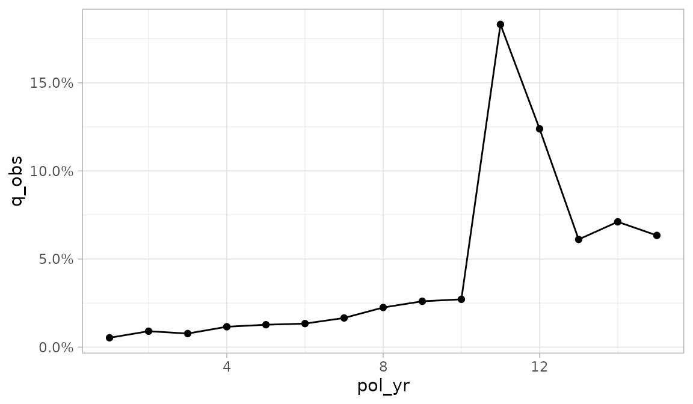

If there is a second grouping variable, it is mapped onto color.

``` r

exposed_data |> 
  group_by(pol_yr, inc_guar) |> 
  exp_stats() |> 
  autoplot()
```

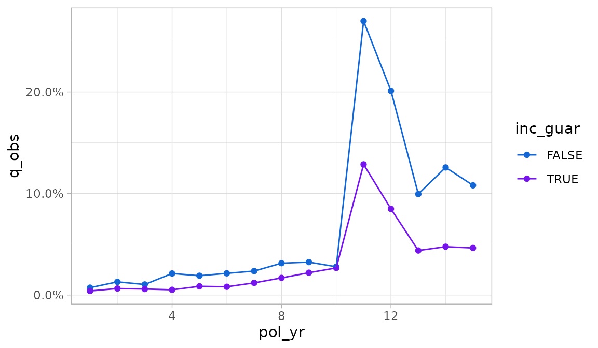

Any additional grouping variables beyond two are used to create facets.

``` r

exp_res2 <- exposed_data |> 
  group_by(pol_yr, product, inc_guar) |> 
  exp_stats() 

autoplot(exp_res2)
```

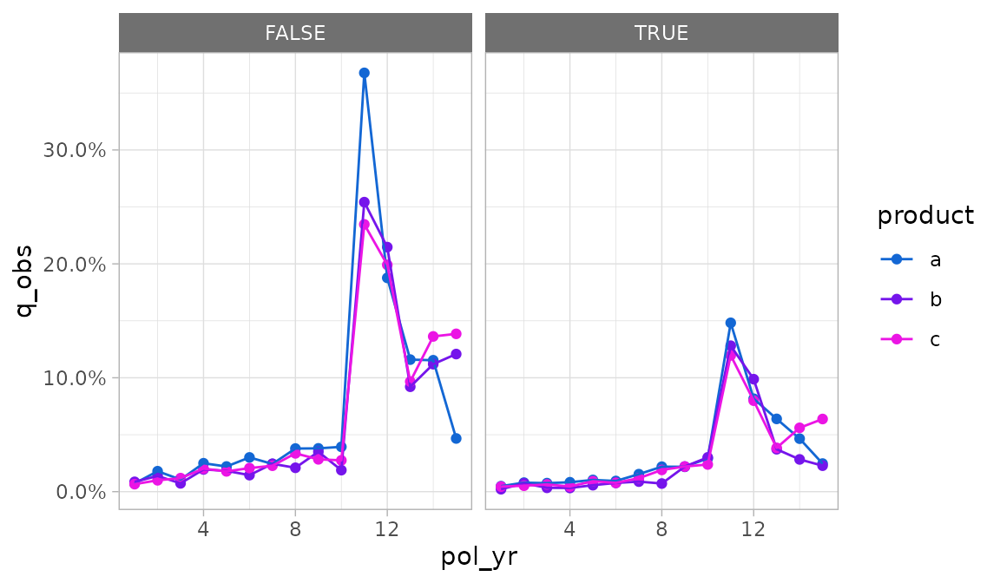

**[`autoplot.exp_df()`](https://mattheaphy.github.io/actxps/reference/autoplot_exp.md)
arguments**

There are two means of overriding the default aesthetics selected by
[`autoplot.exp_df()`](https://mattheaphy.github.io/actxps/reference/autoplot_exp.md).

1.  The `x`, `y`, `color`, and `...` arguments can be passed unquoted
    column names or expressions to use as the x, y, color / fill, and
    faceting variables, respectively.
2.  The `mapping` argument can be passed an aesthetic mapping using
    [`ggplot2::aes()`](https://ggplot2.tidyverse.org/reference/aes.html).
    If this argument is supplied, the `x`, `y`, and `color` arguments
    are ignored.

Let’s assume we want to plot the number of claims instead of the
termination rate, and we want `inc_guar` to be the color variable
instead of `product`.

Using the `y`, `color`, and `...` arguments, we could write:

``` r

autoplot(exp_res2, y = claims, color = inc_guar, product)
```

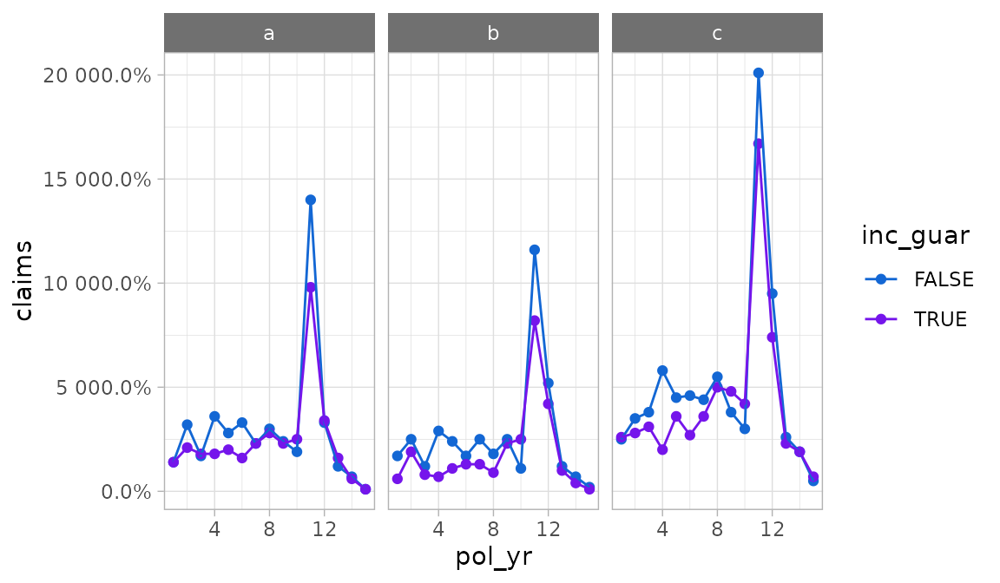

Alternatively, we could supply a mapping for more fine-grained control.
Note that the example below adds an additional mapping for `linetype`
which is otherwise unavailable under the defaults for
[`autoplot.exp_df()`](https://mattheaphy.github.io/actxps/reference/autoplot_exp.md).

``` r

autoplot(exp_res2, 
         mapping = aes(x = pol_yr, y = claims, color = inc_guar,
                       linetype = inc_guar), 
         product)
```

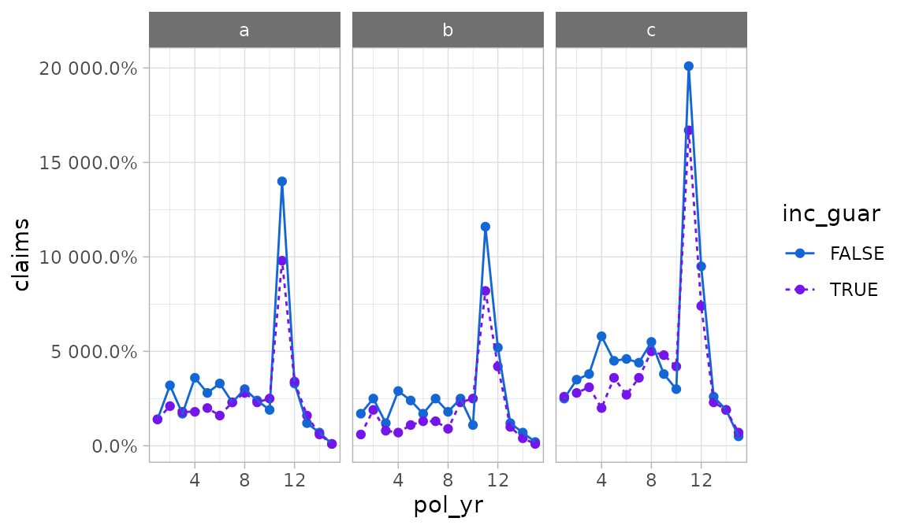

The
[`autoplot.exp_df()`](https://mattheaphy.github.io/actxps/reference/autoplot_exp.md)
function defaults to percentages for y-axis labels. As seen in the
immediately preceding example, this will not always be appropriate. The
`y_labels` function can be used to pass a different labeling function.

``` r

autoplot(exp_res2, y = claims, color = inc_guar, product,
         y_labels = scales::label_comma(accuracy = 1))
```

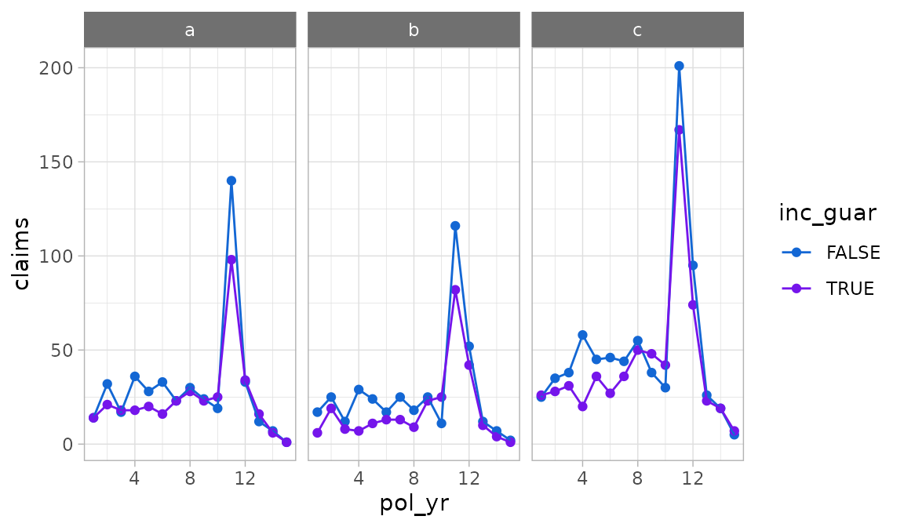

To set axis scales that vary by subplot, use the `scales` argument. This
argument is subsequently forwarded to
[`ggplot2::facet_wrap()`](https://ggplot2.tidyverse.org/reference/facet_wrap.html).
Under the default value “fixed”, scales are identical across subplots.
If “free_y” is passed as shown below, the y-scales will vary. If
“free_x” is passed, the x-scales will vary. If “free” is passed, both
the x- and y-scales will vary.

``` r

autoplot(exp_res2, scales = "free_y")
```

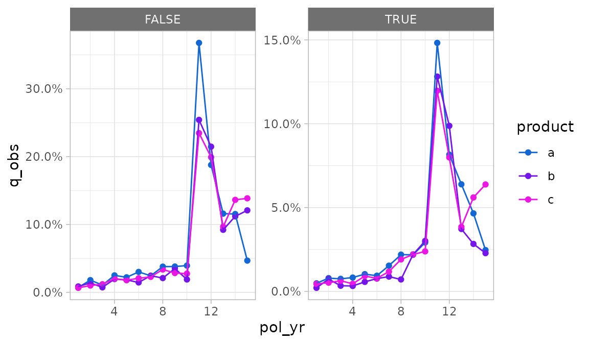

The `geoms` argument can be used to change the plotting geometry. Under
the default value of “lines”, points and lines are displayed. If “bars”
is passed, a bar plot will be drawn. If “points” is passed, a scatter
plot will be drawn.

``` r

autoplot(exp_res, geoms = "bars")
```

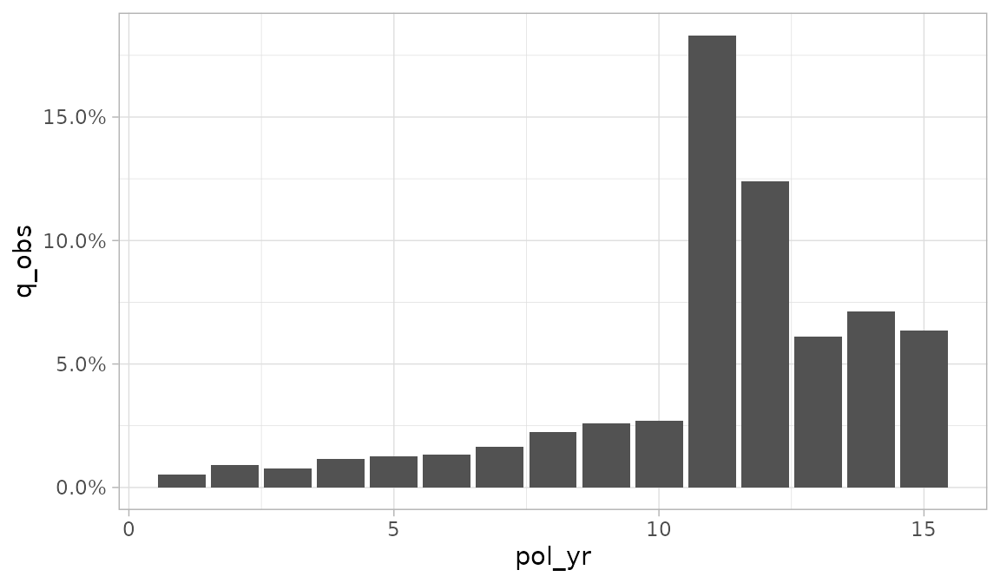

If the `y_log10` argument is set to `TRUE`, the y-axis will be plotted
on a logarithmic base ten scale.

``` r

autoplot(exp_res, y_log10 = TRUE)
```

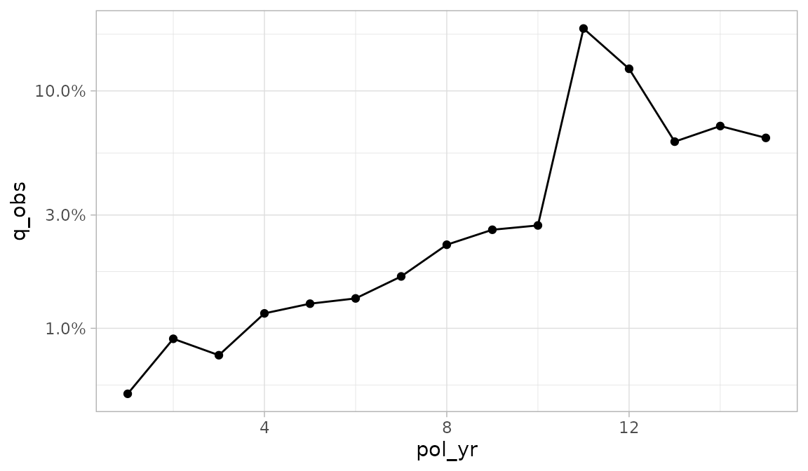

[`autoplot.exp_df()`](https://mattheaphy.github.io/actxps/reference/autoplot_exp.md)
contains a handful of arguments for plotting an additional variable on
the y-axis. This variable defaults to exposures and will always use an
area geometry.

- To add a second y-axis, set `second_axis` to `TRUE`.
- The `second_y` argument specifies which variable is plotted on the
  second y-axis.
- The `second_y_labels` argument is used to change the labels on the
  second y-axis. Since exposures are the default second y-axis variable,
  labels are defaulted to a whole number comma format.

``` r

autoplot(exp_res, second_axis = TRUE)
```

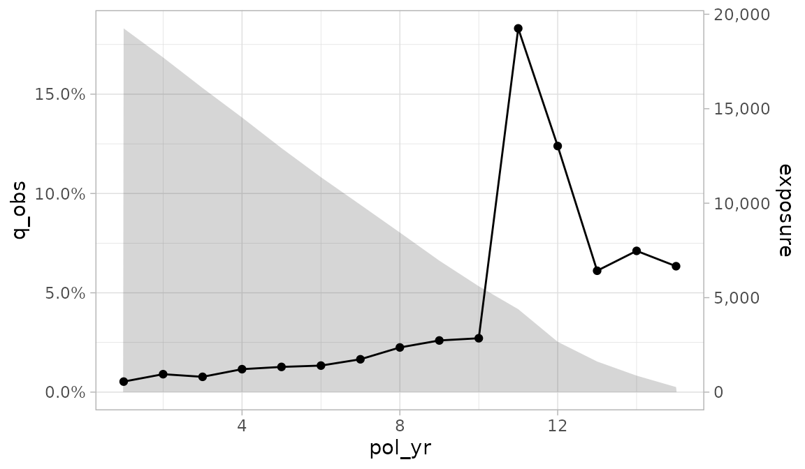

Confidence interval error bars can be added to a plot by passing
`conf_int_bars = TRUE`. Confidence intervals will only be displayed if
they are available for the selected `y` variable.

``` r

autoplot(exp_res, conf_int_bars = TRUE)
```

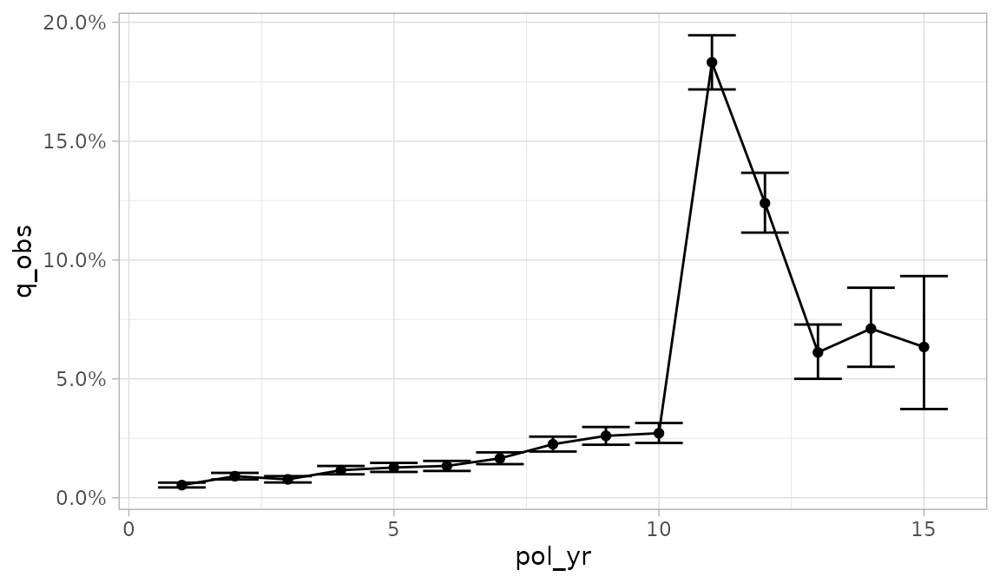

### `plot_termination_rates()`

A limitation of
[`autoplot.exp_df()`](https://mattheaphy.github.io/actxps/reference/autoplot_exp.md)
is that it doesn’t allow one to plot observed termination rates
alongside one or more expected termination rates. This type of plot is
common as an alternative to actual-to-expected ratio plots.

The
[`plot_termination_rates()`](https://mattheaphy.github.io/actxps/reference/plot_special.md)
function produces a plot of the observed termination rates plus any
expected termination rates that were passed to the `expected` argument
of
[`exp_stats()`](https://mattheaphy.github.io/actxps/reference/exp_stats.md).

In the example below, a new `exp_df` object is created that contains two
sets of expected surrender rates. This object is then passed into
[`plot_termination_rates()`](https://mattheaphy.github.io/actxps/reference/plot_special.md).

``` r


exp_res3 <- exposed_data |> 
  group_by(pol_yr) |> 
  exp_stats(expected = c("expected_1", "expected_2"), credibility = TRUE)

plot_termination_rates(exp_res3)
```

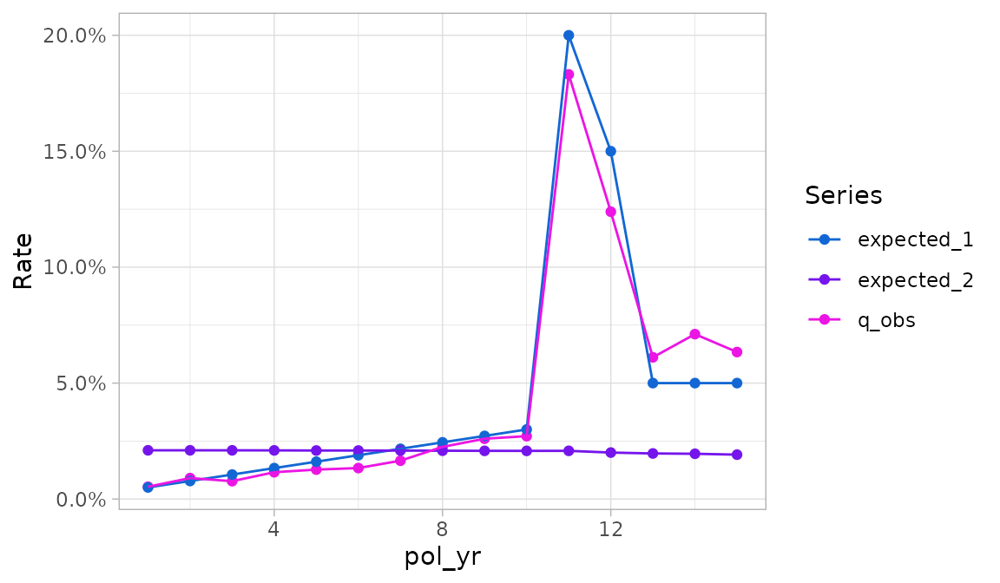

In the plot above, termination rates are mapped to the `y` variable and
the `Series` variable specifies a color scale. Similar to
[`autoplot.exp_df()`](https://mattheaphy.github.io/actxps/reference/autoplot_exp.md),
the `x` variable is the first grouping variable (here, `pol_yr`).

If the `exp_df` object contains credibility-weighted termination
rates[^4], these rates can be included in the plot using the argument
`include_cred_adj = TRUE`.

``` r

plot_termination_rates(exp_res3, include_cred_adj = TRUE)
```

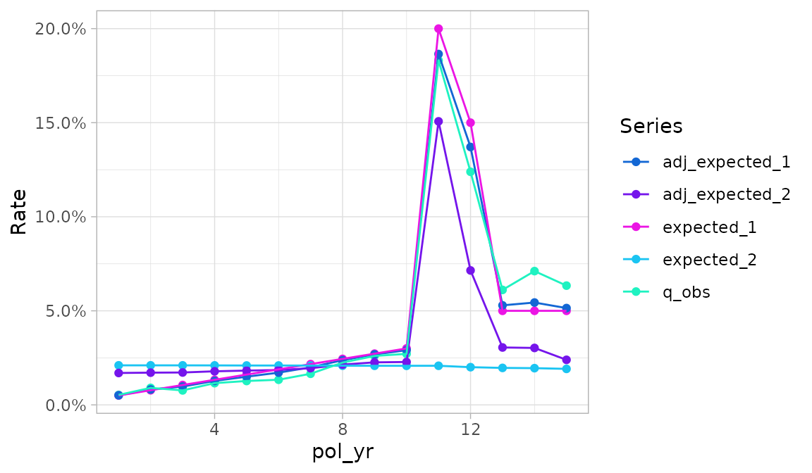

### `plot_actual_to_expected()`

The
[`plot_actual_to_expected()`](https://mattheaphy.github.io/actxps/reference/plot_special.md)
function is similar to
[`plot_termination_rates()`](https://mattheaphy.github.io/actxps/reference/plot_special.md)
except that all actual-to-expected ratios are plotted on the y-axis
instead.

``` r

plot_actual_to_expected(exp_res3)
```

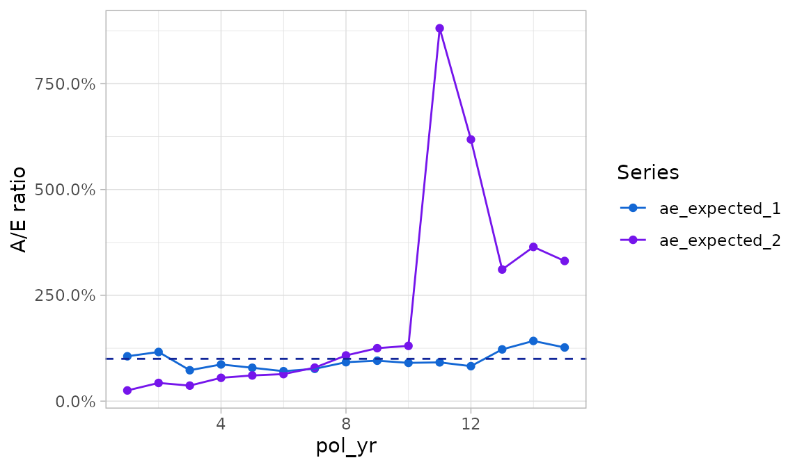

### Relationship of `plot_termination_rates()` and `plot_actual_to_expected()` to `autoplot.exp_df()`

Behind the scenes,
[`plot_termination_rates()`](https://mattheaphy.github.io/actxps/reference/plot_special.md)
and
[`plot_actual_to_expected()`](https://mattheaphy.github.io/actxps/reference/plot_special.md)
call
[`autoplot()`](https://ggplot2.tidyverse.org/reference/autoplot.html)
after reshaping the `exp_df` object. As such, all arguments passed to
[`autoplot.exp_df()`](https://mattheaphy.github.io/actxps/reference/autoplot_exp.md)
described above can also be passed to these functions. However, there is
an exception: the `y` variable is reserved and cannot be modified. In
addition, while the `color` variable can be overridden, this is
discouraged because it may result in odd-looking plots.

Since these functions automatically create a color variable, any
grouping variables beyond the *first* are used to create facets. This
differs from
[`autoplot.exp_df()`](https://mattheaphy.github.io/actxps/reference/autoplot_exp.md)
which uses grouping variables beyond the *second* to create facets

## Plotting transaction studies

The actxps package also provides an
[`autoplot()`](https://ggplot2.tidyverse.org/reference/autoplot.html)
method for `trx_df` objects. The
[`autoplot.trx_df()`](https://mattheaphy.github.io/actxps/reference/autoplot_exp.md)
method has the same arguments as
[`autoplot.exp_df()`](https://mattheaphy.github.io/actxps/reference/autoplot_exp.md),
so all options described in the previous section can be used for
transaction studies as well.

The y variable defaults to the observed transaction frequency
(`trx_util`). Like
[`autoplot.exp_df()`](https://mattheaphy.github.io/actxps/reference/autoplot_exp.md),
any numeric column can be mapped onto the y-axis using the `y` or
`mapping` arguments.

Under the defaults,
[`autoplot.trx_df()`](https://mattheaphy.github.io/actxps/reference/autoplot_exp.md)
handles grouping variables the same as
[`autoplot.exp_df()`](https://mattheaphy.github.io/actxps/reference/autoplot_exp.md):

- The first grouping variable is mapped onto `x`
- The second grouping variable is mapped onto color
- Any additional grouping variables are used to create subplots

In addition to the above, facets are also created for each transaction
type found in the data.

``` r

trx_res <- exposed_data |> 
  group_by(pol_yr, inc_guar) |> 
  trx_stats(percent_of = "premium")

trx_res |> 
  autoplot(y = pct_of_premium_all, second_axis = TRUE)
```

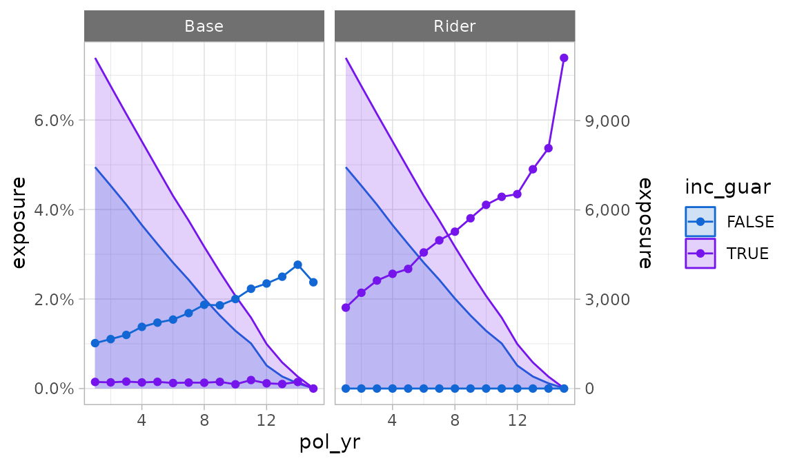

### `plot_utilization_rates()`

The
[`plot_utilization_rates()`](https://mattheaphy.github.io/actxps/reference/plot_special_trx.md)
function creates a side-by-side view of both transaction frequency and
severity. This type of plot is useful for answering questions like,
*“what percentage of customers are taking withdrawals each quarter, and
of those taking withdrawals, what is the average percentage of account
value taken out?”*.

Transaction frequency is represented by utilization rates (`trx_util`).
Severity is represented by transaction amounts as a percentage of one or
more other columns in the data. All severity series begin with the
prefix `pct_of_` and end with the suffix `_w_trx`. The suffix refers to
the fact that the denominator only includes records with non-zero
transactions. Severity series are automatically selected based on column
names passed to the `percent_of` argument in
[`trx_stats()`](https://mattheaphy.github.io/actxps/reference/trx_stats.md).
If no “percentage of” columns exist, this function will only plot
utilization rates.

Like
[`plot_termination_rates()`](https://mattheaphy.github.io/actxps/reference/plot_special.md)
and
[`plot_actual_to_expected()`](https://mattheaphy.github.io/actxps/reference/plot_special.md),
this function calls
[`autoplot()`](https://ggplot2.tidyverse.org/reference/autoplot.html)
after reshaping the data. All arguments passed to
[`autoplot.trx_df()`](https://mattheaphy.github.io/actxps/reference/autoplot_exp.md)
can be utilized by this function except `y` and `scales`. The `y`
argument is reserved for utilization rates, and the `scales` argument is
preset to allow differing scales between the frequency and severity
subplots.

``` r

plot_utilization_rates(trx_res)
```

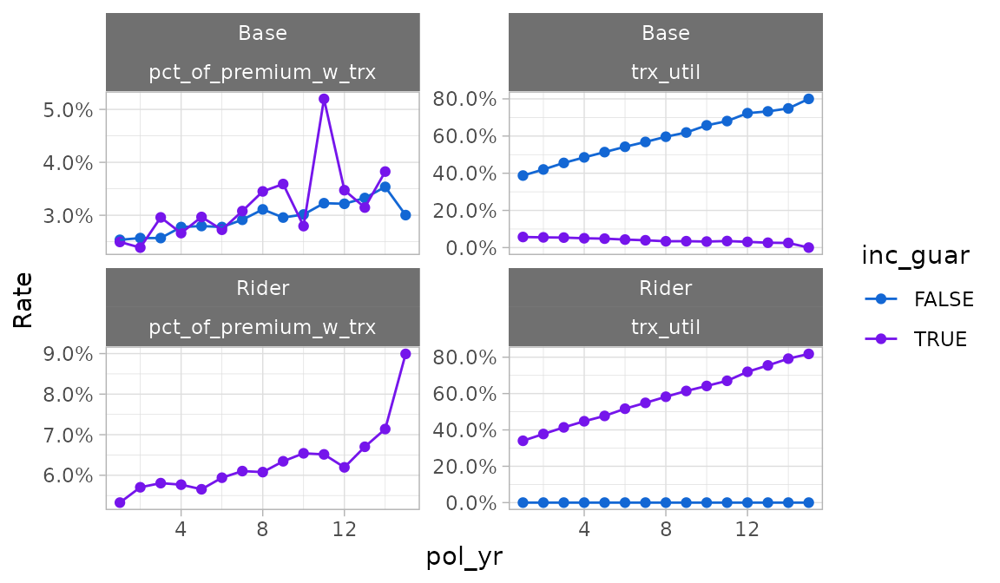

## Tables

The
[`autotable()`](https://mattheaphy.github.io/actxps/reference/autotable.md)
function creates summary tables of termination or transaction study
results. This function is a generic function with methods specific to
`exp_df` and `trx_df` objects.

### Termination study output example


### Transaction study output example


**Arguments**:

- `fontsize` is a multiple that increases or decreases the font size.
  Values less than 100 decrease the font size, and values greater than
  100 increase the font size.

- `decimals` controls the number of decimal places displayed for
  percentage columns (default = 1)

- If `colorful` is `TRUE`, conditional color formatting will be added to
  the table.

  - For termination studies, `color_q_obs` and `color_ae_` specify the
    color palettes used for observed termination rates and
    actual-to-expected ratios, respectively.
  - For transaction studies, `color_util` and `color_pct_of` specify the
    color palettes used for utilization rates and “percentage of”
    columns, respectively.

  These inputs must be strings referencing a discrete color palette
  available in the `paletteer` package. Palettes must be in the form
  “package::palette”. For a full list of available palettes, see
  [`paletteer::palettes_d_names`](https://emilhvitfeldt.github.io/paletteer/reference/palettes_d_names.html).

- `rename_cols` can be used to relabel columns. This input must be a
  named list or character vector with names equal to original column
  names and values equal to the desired column labels. Most of the
  column names created by
  [`autotable()`](https://mattheaphy.github.io/actxps/reference/autotable.md)
  are presentation-ready, however, grouping variables on the left side
  of the table may require updates since they default to the variable
  names that appear in the data.

- `show_conf_int` and `show_cred_adj` can be used to include any
  confidence intervals and credibility-weighted termination rates, if
  available. As a default, these columns are not included to avoid
  producing overcrowded tables.

- `show_total` can be used to add grand total rows to tables.

## Interactive Shiny app

[`exp_shiny()`](https://mattheaphy.github.io/actxps/reference/exp_shiny.md)
is a powerful function that launches an interactive Shiny app containing
filters, grouping variables, plots produced by
[`autoplot()`](https://ggplot2.tidyverse.org/reference/autoplot.html),
tables produced by
[`autotable()`](https://mattheaphy.github.io/actxps/reference/autotable.md),
and exporting capabilities. This function requires an `exposed_df`
object[^5].

The left sidebar of the app contains filtering widgets organized by data
type for all variables passed to the `predictors` argument. If
`predictors` is not specified, all columns in the data except policy
numbers, statuses, termination dates, exposures, and transaction columns
will be used. The type of widget will vary depending on the data type
and number of unique values in each predictor.

At the top of the sidebar, information is shown on the percentage of
records remaining after applying filters. A text description of all
active filters is also provided.

The top of the sidebar also includes a “play / pause” switch that can
pause reactivity of the app. Pausing is a good option when multiple
changes are made in quick succession, especially when the underlying
data set is large.

The “Grouping variables” box includes widgets to select grouping
variables for summarizing experience. The “x” widget determines the x
variable in the plot output. Similarly, the “Color” and “Facets” widgets
are used for color and facets. Multiple faceting variable selections are
allowed. For the table output, “x”, “Color”, and “Facets” have no
particular meaning beyond the order in which grouping variables are
displayed.

The “Study type” box will always include a tab for termination studies.
If transactions are attached to the `exposed_df` object[^6], an
additional section will be displayed for transaction studies.

- Termination study options include the ability to activate and
  deactivate expected values, the selection of an optional numeric
  weighting variable for claims and exposures, and the selection of
  control variables. Available expected value choices are dictated by
  the `expected` argument. If this argument is not specified, any
  columns containing the word “expected” are assumed to be expected
  values.
- Transaction study options include the ability to activate and
  deactivate transaction types, optional numeric columns to use in
  “percentage of” statistics, and an option to lump all transaction
  types into a single category.

The output section includes tabs for plots, tables, and exporting
results.

The plot tab includes a plot and various options for customization:

- y: y variable
- Geometry: plotting geometry - bars, points and lines, or points only
- Second y-axis: enables a second y-axis
- Second axis y: y variable to plot on the second axis using an area
  geometry. The default is exposures.
- Add Smoothing: plots smooth loess curves
- Confidence intervals: If available, add confidence intervals error
  bars for around the selected y variable
- Free y Scales: enables separate y scales in each plot
- Log y-axis: plots all y-axes on a log-10 scale
- The gear icon above the plot contains a pop-up menu for updating the
  size of the plot.

The table tab includes the table itself plus a pop-up menu for changing
the table’s appearance:

- The “Total row”, “Confidence intervals”, and “Credibility-weighted
  termination rates” switches add these outputs to the table. These
  values are hidden as a default to prevent over-crowding.
- The “Include color scales” switch disables or re-enables conditional
  color formatting.
- The “Decimals” slider controls the number of decimals displayed for
  percentage fields.
- The “Font size multiple” slider impacts the table’s font size

The export pop-up menu contains options for saving summarized experience
data, the plot, or the table. Data is saved as a CSV file. The plot and
table are saved as png files.


**Other arguments**

- `distinct_max`: an upper limit on the number of distinct values a
  variable is allowed to have to be included as a viable option for the
  color and facets grouping variables. Default = 25.
- `title`: an optional title for the app
- `credibility`, `conf_level`, `cred_r`: credibility options for
  termination studies. See
  [`exp_stats()`](https://mattheaphy.github.io/actxps/reference/exp_stats.md)
  for more information. Limited fluctuation credibility estimates at a
  95% confidence within 5% of the theoretical mean assuming a binomial
  distribution are used as a default.
- The `conf_level` argument is also used for confidence intervals for
  both termination and transaction studies.
- `theme`: replace the default theme of the app by passing the name of a
  theme accepted by the `preset` argument in
  [`bslib::bs_theme()`](https://rstudio.github.io/bslib/reference/bs_theme.html).
  Alternatively, a complete theme created by
  [`bslib::bs_theme()`](https://rstudio.github.io/bslib/reference/bs_theme.html)
  can be passed as well.

[^1]: `exp_df` objects are created by
    [`exp_stats()`](https://mattheaphy.github.io/actxps/reference/exp_stats.md)
    see
    [`vignette("exp_summary")`](https://mattheaphy.github.io/actxps/articles/exp_summary.md)
    for more information

[^2]: `trx_df` objects are created by
    [`trx_stats()`](https://mattheaphy.github.io/actxps/reference/trx_stats.md)
    see
    [`vignette("transactions")`](https://mattheaphy.github.io/actxps/articles/transactions.md)
    for more information

[^3]: If there are no grouping variables, a single point is plotted

[^4]: See the `credibility` argument of
    [`exp_stats()`](https://mattheaphy.github.io/actxps/reference/exp_stats.md)
    for more information

[^5]: See
    [`expose()`](https://mattheaphy.github.io/actxps/reference/expose.md)
    or
    [`as_exposed_df()`](https://mattheaphy.github.io/actxps/reference/is_exposed_df.md)
    for more information

[^6]: See
    [`add_transactions()`](https://mattheaphy.github.io/actxps/reference/add_transactions.md)
    for information on attaching transactions to an `exposed_df` object.
